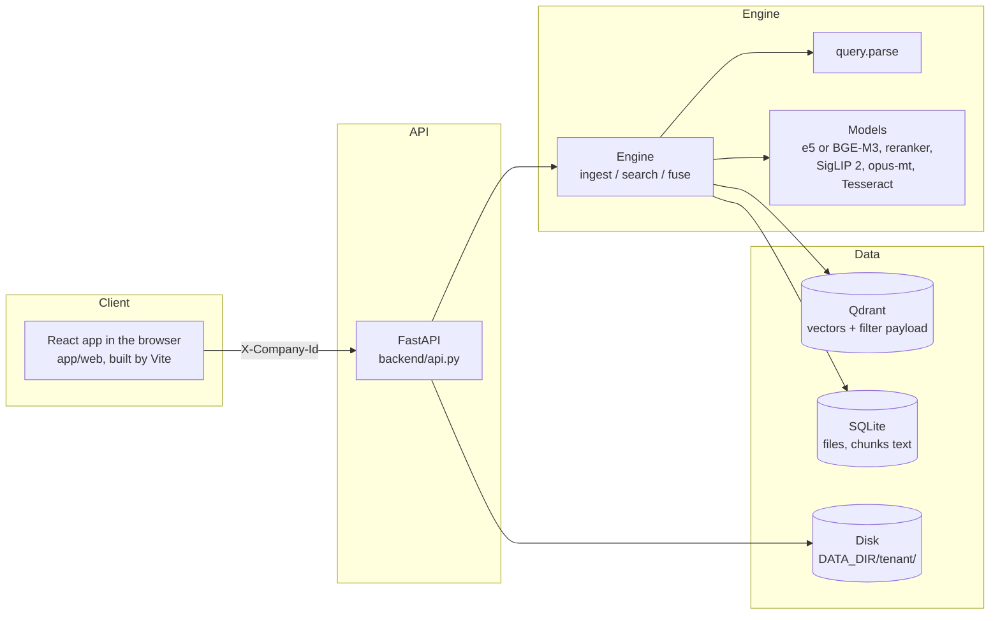
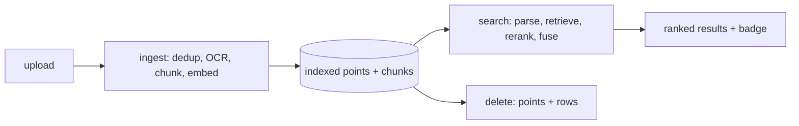

Classification: INTERNAL

# chatfind architecture

This is the hub. Each topic has its own folder under `flows/`, and a single spoke is enough to work on its topic. This folder describes the code as it is today.

## What it is

It's a self-hosted semantic search for chat media and attachments, built from open-source parts. You describe a file in Indonesian or English and get back matching photos, PDFs and receipts, and only ever your own tenant's files. It's one Python process: FastAPI serves the API and the built React page, and the `Engine` does ingest and search. Vectors live in Qdrant (embedded, or a server), chunk text in SQLite, files on disk. There are no external APIs: every model runs locally.

## System overview

Everything is synchronous today. A queue-based pipeline (Kafka, worker pools, a GPU service) is planned but doesn't exist in code yet.

## File lifecycle

## Topic index

| Topic | What it covers | Status | Link |
|---|---|---|---|
| Ingest | Upload → dedup → OCR/chunk → vectors, schema | ready | [flows/ingest](flows/ingest/README.md) |
| Search | Hybrid text path, visual path, rerank, fusion, badges | ready | [flows/search](flows/search/README.md) |
| Query understanding | ID/EN date, channel and type parsing | ready | [flows/query-understanding](flows/query-understanding/README.md) |
| API | Routes, validation, errors, file serving | ready | [flows/api](flows/api/README.md) |
| Frontend | React page flows, rendering safety, test ids | ready | [flows/frontend](flows/frontend/README.md) |
| Evaluation | Golden sets, gate, tuning, corpus | ready | [flows/evaluation](flows/evaluation/README.md) |
| Tenant isolation | Where `company_id` is enforced, known gaps | ready | [flows/cross-cutting/tenant-isolation](flows/cross-cutting/tenant-isolation/README.md) |
| Config and models | Env vars, backends, loading, tuned knobs | ready | [flows/cross-cutting/config-and-models](flows/cross-cutting/config-and-models/README.md) |
| Testing | Fixtures, coverage gates, Vitest, Playwright, CI | ready | [flows/cross-cutting/testing](flows/cross-cutting/testing/README.md) |

## Not covered

| Item | Why |
|---|---|
| `poc/` | The first single-file prototype, superseded by `app/` and kept only for reference |
| Async processing | Not built. |
| Observability | Not built. The only metric is `took_ms` in the search response. |
| Production auth | Not built. See [tenant-isolation](flows/cross-cutting/tenant-isolation/README.md#known-gaps-access-control). |

## How to use these docs

- Humans: read "What it is", then open the spoke for what you're changing.
- AI agents: load just the spoke you need. Diagrams and examples are inline, so you don't need other files.
- When you change code listed in a spoke's `code:` frontmatter, check whether the doc still holds (see [CONVENTIONS.md](CONVENTIONS.md#when-to-update)).
- Terms are defined in [GLOSSARY.md](GLOSSARY.md).
