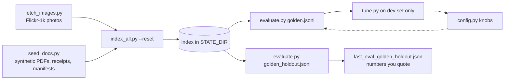

Classification: INTERNAL

# Evaluation

## TL;DR

Search quality is measured, not eyeballed. There are two golden sets of queries with known right answers: a dev set we tune on (73 queries) and a blind set we never tune on (30). `eval/evaluate.py` scores the current engine against one of them and checks for cross-tenant leaks, and it fails if any gate is missed. Quote the blind numbers. The dev numbers are optimistic by construction.

## The loop

## Golden sets

Each row is `{"cat": ..., "query": ..., "expected": [file_id, ...]}`. A query counts as found at the best rank of any expected file.

| Set | Total | image_en | image_id | doc | ocr | filter |
|---|---|---|---|---|---|---|
| `golden.jsonl` (dev) | 73 | 20 | 20 | 20 | 8 | 5 |
| `golden_holdout.jsonl` (blind) | 30 | 8 | 8 | 8 | 4 | 2 |

Keep the blind set blind. Don't add its misses to the dev set, and don't change a knob because of a blind-set result.

## Gate

The gate is defined in `evaluate.py:19` and mirrored in `STANDARD.md`. If you change one, change the other.

| Metric | Must be |
|---|---|
| Recall@10 overall | ≥ 0.90 |
| MRR@10 overall | ≥ 0.75 |
| Recall@1 overall | ≥ 0.65 |
| Recall@10 in every category | ≥ 0.80 |
| Cross-tenant leaks | 0 |

For the leak check, every query is also run as `tenant_other`. Any hit that isn't in `tenant_other/manifest.json` is a leak. The check also confirms that `tenant_other` finds its own refund invoice first (`evaluate.py:43-49`). `STANDARD.md` adds engineering gates (p95 under 1,500 ms, 0 console errors) and usability rules.

## Scripts

| Script | What it does | Watch out |
|---|---|---|
| `evaluate.py` | Metrics per category, p50/p95 latency, leak check. Flags: `--verbose`, `--no-parser`, `--golden=` | Overwrites `last_eval_<set>.json` (`:75`). Pins `QUERY_NOW` to `data/seeded_at.txt`. |
| `tune.py` | Computes candidates once, then grid-searches 8 fusion params, ranked by (MRR, R@10, R@1). Even rows of each category are the tune fold and odd rows are held out. `--swap` flips the folds. | Writes `tuned_params.json` only when run without `--swap`. Tuning is two manual runs, not an automatic loop. |
| `seed_docs.py` | Writes synthetic PDFs, receipt PNGs and each tenant's `manifest.json` (`{"<dir>/<name>": {"channel", "created_at"}}`), plus `seeded_at.txt`. Random seed 7. | Everything is synthetic. Keep it that way. |
| `fetch_images.py` | Downloads N Flickr-1k test images (default 120) and `captions.json`. It can resume. | Research-use licence. Don't commit or redistribute. |
| `index_all.py` | Ingests every tenant manifest. `--reset` wipes all tenants first. | Failed files are logged and skipped. |

`pytest -m accuracy` (`tests/test_accuracy.py`) runs the same gate with real models. It's skipped when no index is built.

## Latest results (2026-09-30, laptop CPU, blind set)

| Backend | R@10 | MRR@10 | R@1 | p95 |
|---|---|---|---|---|
| e5 (demo default) | 0.967 | 0.884 | 0.833 | 352 ms |
| bge-m3 | 0.967 | 0.923 | 0.900 | 2,256 ms |

The misses left on both backends are 3 Indonesian image queries, which go through the SigLIP and translation path. The iteration history is in `app/eval/TUNING.md`. Thirty queries is small: one query moves Recall by about 3 points.

## See also

- [search](../search/README.md)
- [config-and-models](../cross-cutting/config-and-models/README.md)
