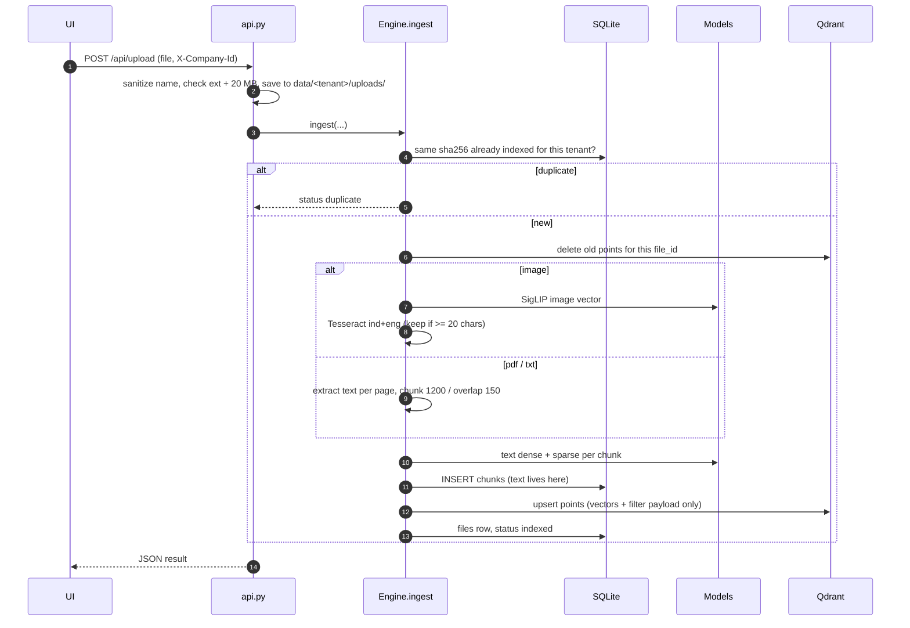
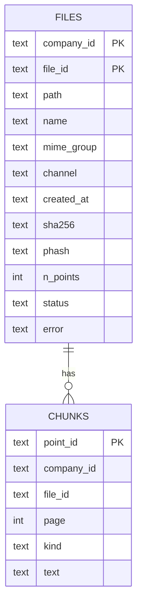

Classification: INTERNAL

# Ingest

## TL;DR

Ingest turns one uploaded file into searchable points. An image gets one visual vector, plus an OCR text chunk if it has at least 20 characters of readable text. A PDF or TXT file gets one text chunk for every 1,200 characters. Vectors go to Qdrant, and the chunk text goes to SQLite. The whole thing runs synchronously inside the upload request. There is no queue yet.

## Entry points

- `app/backend/api.py:99` `POST /api/upload`: user upload from the UI.
- `app/eval/index_all.py` bulk-indexes `data/<tenant>/manifest.json`. It's used for the demo corpus.
- `app/backend/engine.py:228` `Engine.ingest(company_id, path, file_id, channel, created_at)` does the actual work.

## Sequence



1. The API cleans the filename (`SAFE` regex, max 120 chars), checks the extension and the 20 MB limit, and writes the file under the tenant's `uploads/` folder (`api.py:102-111`).
2. `ingest` hashes the bytes. If the same tenant already has an indexed file with that sha256, it returns `duplicate` and stops (`engine.py:235-239`).
3. Existing points for the same `file_id` are deleted, so re-uploading a file re-indexes it (`engine.py:240`).
4. Images are rotated by EXIF and converted to RGB, which drops the EXIF metadata (GPS included). They're thumbnailed to 1024 px and embedded with SigLIP. Tesseract OCR runs, and its text is kept only above `OCR_MIN_CHARS` (`engine.py:246-254`).
5. PDFs are read page by page with pypdf. Chunks are 1,200 characters with a step of 1,050 (`engine.py:217-222, 257-261`). A PDF with no text layer (a scan) is marked `skipped`, because there's no OCR for PDFs yet (`engine.py:262-265`).
6. Each chunk gets a dense vector and a sparse vector (`engine.py:267-274`). The chunk text is written to SQLite, and Qdrant stores vectors plus filter fields only.

## Schema



The schema is defined at `engine.py:178-187`. The indexes are `ix_chunks_file(company_id, file_id)` and `ix_files_sha(company_id, sha256)`.

The Qdrant collection is defined at `engine.py:189-206`:

| Vector | Type | Size |
|---|---|---|
| `text` | dense, cosine | 384 (e5) or 1024 (bge-m3) |
| `image` | dense, cosine | 768 |
| `text_sparse` | sparse | IDF modifier for e5, none for bge-m3 |

It uses scalar INT8 quantization kept in RAM. The payload indexes are `company_id` (keyword, `is_tenant=True`), `file_id`, `mime_group` and `channel` (keyword), and `created_at` (datetime).

## Key components

| Component | File | Role |
|---|---|---|
| `Engine.ingest` | `app/backend/engine.py:228` | The whole pipeline above |
| `_chunks` | `app/backend/engine.py:217` | Fixed-size character windows |
| Point id | `app/backend/engine.py:225` | `uuid5(company_id\|sha\|idx\|v1)`, so the same bytes always give the same id |
| `doc_vector` / `query_vector` | `app/backend/sparse.py:38, 47` | BM25 term weights (K1 1.2, B 0.75, avg length 60). Tokens are hashed with blake2b, and Indonesian `-nya/-lah/-kah` suffixes are stripped. |
| `Engine.delete` | `app/backend/engine.py:285` | Removes points by `company_id` + `file_id`, then deletes the SQL rows |

## Data

Qdrant payload for an image that has OCR text:

```json
{"company_id": "tenant_demo", "file_id": "uploads/receipt.jpg", "channel": "upload",
 "created_at": "2026-09-30T03:00:00+00:00", "mime_group": "image", "kind": "visual", "has_ocr": true}
```

A document chunk payload has `"kind": "text"` and a `page` number instead of `has_ocr`.

Return value of `ingest()`:

```json
{"file_id": "uploads/receipt.jpg", "status": "indexed", "points": 2, "mime_group": "image", "ocr": true}
```

## Failure and state

**Status values.** `indexed`, `duplicate` and `skipped` are the only statuses. There's no `failed` status. Any exception reaches the API, which deletes the saved file and returns HTTP 422 (`api.py:114-116`).

**Known gaps**, all confirmed in the code:

- The old version is deleted before the new one is embedded. If embedding or upsert fails, the file disappears from the index.
- `_lock` only covers the dedup check and the delete (`engine.py:235-240`). Two uploads of the same bytes at the same moment can both be indexed.
- A `duplicate` upload leaves its copy on disk.
- Two uploads with the same name overwrite each other on disk (`api.py:109`).
- `phash` is stored but not used. Dedup is exact bytes only.

**State.** Files live in `DATA_DIR/<tenant>/`, the index in `STATE_DIR/qdrant/`, and the chunk text plus file rows in `STATE_DIR` SQLite.

## See also

- [search](../search/README.md)
- [tenant-isolation](../cross-cutting/tenant-isolation/README.md)
- [config-and-models](../cross-cutting/config-and-models/README.md)
