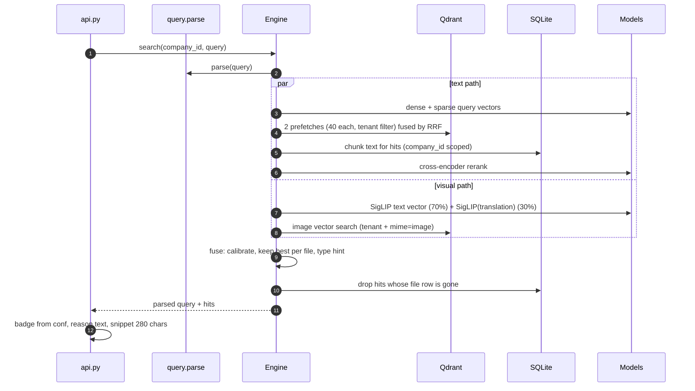

Classification: INTERNAL

# Search

## TL;DR

A query goes down two paths at once. The text path runs dense and BM25 search over document and OCR chunks, merges them with RRF, and reranks with a cross-encoder. The visual path compares the query against image vectors with SigLIP, using an English translation blended in. `fuse` puts both on one probability scale, keeps the best evidence per file, and returns a single ranked list. Most accuracy work happens in this file.

## Entry points

- `app/backend/api.py:76` `POST /api/search`
- `app/backend/engine.py:308` `Engine.search(company_id, query, k, type_filter, channel)`
- `app/eval/evaluate.py` and `app/eval/tune.py` call `candidates` and `fuse` directly, so they can tune fusion offline without re-running retrieval.

## Sequence



1. `parse` pulls out dates, channel and type hint. A `channel` sent in the request overrides the parsed one (`engine.py:316-318`).
2. Text path: two Qdrant prefetches (dense on `text`, sparse on `text_sparse`), each with the tenant filter and `CANDIDATES`=40, fused server-side with `Fusion.RRF` (`engine.py:326-333`).
3. Visual path: the SigLIP text tower encodes the query. When `QUERY_TRANSLATE` is on, it also encodes the opus-mt English translation and mixes the two at `TRANSLATE_WEIGHT`=0.3 before searching `image` (`engine.py:338-350`). The translation exists because SigLIP is much better at English.
4. The text candidates are reranked. Their chunk text is read from SQLite with `company_id=?`, and the cross-encoder returns a probability for each (`engine.py:353-361`).
5. `fuse` scores everything (`engine.py:365-409`). The next section has the details.
6. `search` slices to `k` and then drops hits that no longer have a `files` row (`engine.py:308-312`). A deleted file can therefore make a page shorter than `k`.

## Fusion

Text relevance and image similarity come out of different models on different scales. `fuse` converts each to a probability with a temperature and bias tuned on the dev golden set.

| Evidence | Formula | Extra weight |
|---|---|---|
| Text or OCR chunk | `sigmoid(TEXT_TEMP * logit(p) + TEXT_BIAS + DISTINCT_WEIGHT * z)` | OCR chunks × `OCR_WEIGHT` 0.6 (OCR text is noisy) |
| Image | `sigmoid(IMAGE_TEMP * siglip_logit + IMAGE_BIAS + DISTINCT_WEIGHT * z)` | × `VISUAL_ON_TEXT_IMAGE_WEIGHT` 0.3 if the image has OCR text, because SigLIP "reading" a receipt repeats what OCR already found |

- `z` is how far a candidate stands out from the others in its modality: `max(0, (x - mean) / std)`, and 0 when there are fewer than 3 candidates (`engine.py:36-42`).
- Only the highest-scoring hit per file is kept (`_keep`, `engine.py:411`).
- If a file matched both visually and through OCR, the result shows the OCR snippet. Its badge confidence is combined with noisy-OR, `1 - (1-a)(1-b)` (`engine.py:396-402`).
- If the query says "foto" or "invoice" and the user hasn't set a type filter, hits of the other modality are multiplied by `TYPE_HINT_PENALTY` 0.2 (`engine.py:405-408`). The penalty is soft, so a very strong PDF can still show up for a "foto" query.

Current values are in `app/backend/config.py:52-58`. They were tuned for e5 on 2026-09-30.

## Confidence badge

The badge uses `conf`, the calibrated probability, before any ranking-only multipliers. `score` is used for ordering only.

| `conf` | Badge | Where |
|---|---|---|
| ≥ 0.65 (`STRONG_CONFIDENT`) | `strong` | `api.py:43` |
| ≥ 0.45 (`MIN_CONFIDENT`) | `good` | `api.py:45` |
| lower | `weak` | `api.py:47` |

The thresholds come from dev-set score distributions. At 0.65 there were no non-relevant hits above the line; at 0.45 precision was 0.81.

## Data

Request:

```json
{"query": "foto struk bensin via wa minggu lalu", "type": null, "channel": null, "limit": 12}
```

Response. The keys match the code; the values are illustrative.

```json
{"query": "foto struk bensin via wa minggu lalu",
 "understood": {"search_text": "struk bensin", "translated": "gasoline receipt", "date": "7 hari terakhir",
   "type_hint": "image", "channel": "whatsapp", "date_from": "2026-09-23T00:00:00+07:00"},
 "took_ms": 412,
 "results": [{"file_id": "wa/struk_01.jpg", "name": "struk_01.jpg", "mime_group": "image", "channel": "whatsapp",
   "created_at": "2026-09-27T09:12:00+07:00", "score": 0.4321, "confidence": "strong", "match": "ocr",
   "reason": "Teks di dalam gambar cocok", "page": 1, "snippet": "SPBU ... PERTALITE ..."}]}
```

`reason` is Indonesian UI text, chosen by the kind of match (`api.py:50-53`). `understood` has no `date_to`.

## Failure and state

Search is read-only. It fails only if Qdrant or a model fails to load, and those errors surface as HTTP 500. Nothing is cached apart from the translation cache (5,000 entries, cleared when full, `engine.py:117-133`).

## See also

- [query-understanding](../query-understanding/README.md)
- [evaluation](../evaluation/README.md): every change here has to pass the gate.
- [ingest](../ingest/README.md)
